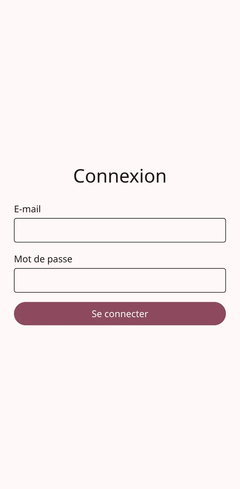
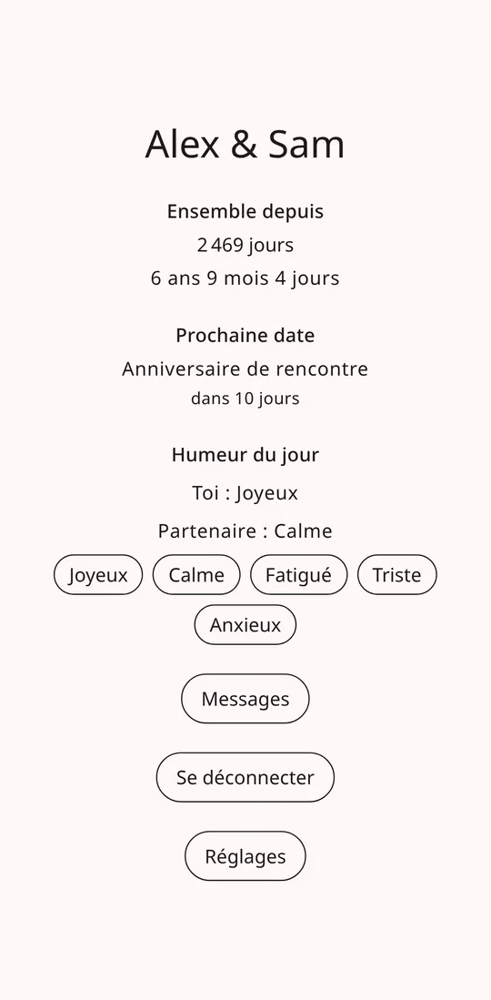

<h1 align="center">OpenLove 💞</h1>

<p align="center">
  App de couple auto-hébergeable : chat temps réel, surprises et lettres verrouillées dans le temps,
  collections partagées et calendrier.<br>
  Web (PWA) et Android, une instance par couple.
</p>

<p align="center">
  <a href="https://github.com/BaptisteLOpenSource/OpenLove/actions/workflows/ci.yml"></a>
  <a href="LICENSE"></a>
  
  <a href="CONTRIBUTING.md"></a>
  <a href="CODE_OF_CONDUCT.md"></a>
</p>

<p align="center">
  
  
  
  
  
</p>

<p align="center">
  
  
  
  
</p>

<p align="center"><sub>Données de démonstration (seed). Thème clair et sombre calculés depuis une seule couleur de base.</sub></p>

## Sommaire

- [À propos](#à-propos)
- [Statut](#statut)
- [Démarrage rapide](#démarrage-rapide-sans-terminal)
- [Fonctionnalités](#fonctionnalités-v1)
- [Stack](#stack)
- [Démarrage développeur](#démarrage-développeur)
- [Contribuer](#contribuer)
- [Documentation](#documentation)
- [Licence](#licence)

## À propos

**OpenLove** est la réécriture open source de l'application privée d'un couple. Rien de personnel
n'est livré : ni noms, ni contenu privé, ni éléments personnels. Tu déploies, tu configures, et ça
devient la tienne.

Conçue pour deux personnes, pas pour une plateforme. Une instance sert un seul couple, tu gardes tes
données (ton Supabase, ton stockage), et la révélation des surprises est décidée par l'horloge du
serveur : rien ne peut être spoilé depuis le client.

## Statut

En développement. L'Epic E0 (squelettes web et Android, CI) est terminée ; les fonctionnalités
arrivent epic par epic. Suis l'avancement sur le tableau de projet GitHub.

## Démarrage rapide (sans terminal)

1. Cliquer sur **Deploy to Vercel** (lien ajouté à la première version).
2. Ouvrir ton nouveau site : la page **/setup** te guide pour Supabase, Firebase et les clés à
   coller dans Vercel, en vérifiant chacune en direct.
   Étapes détaillées : [docs/install.md](docs/install.md).
3. Renseigner vos prénoms, la date de début et la couleur. Terminé.
4. Android : télécharger l'APK depuis Releases, ouvrir **Réglages** sur le web, scanner le QR code.

## Fonctionnalités (v1)

- **Accueil** : compteur de jalon, compte à rebours de la prochaine date, humeur du jour
- **Chat** : messages temps réel, indicateur de frappe, accusés de lecture, images, GIF, lieux
  partagés (aperçu de carte, ouverture dans Google Maps). Texte chiffré au repos.
- **Surprises et lettres** : écrites à l'avance, révélées par l'horloge serveur uniquement
  (sans spoiler)
- **Collections** : lieux, films (TMDB), activités, partagées entre les deux partenaires
- **Calendrier** : dates spéciales, calendriers `.ics` abonnés, rappels
- **Notifications push** : Firebase Cloud Messaging sur web et Android, aucun contenu de message
  affiché
- **Tes photos, ton cloud** : médias stockés dans ton propre Supabase Storage (Google Drive plus tard)
- **Material 3** : une seule couleur de base thème l'app web et l'app Android
- **App Android** : scanner un QR code sur la page réglages du web, et c'est tout

Plus tard : RadioBox (playlists YouTube partagées), extension Chrome, stockage Google Drive,
installation Docker/VPS, locale anglaise.

## Stack

| Couche | Choix |
|---|---|
| Web + API | Next.js (App Router) + TypeScript strict + Tailwind (tokens M3) + next-intl |
| Validation | Zod (env, entrée/sortie API), exporté en contrats JSON pour Android |
| Données | Supabase (Postgres + RLS, Auth, Storage, Realtime) |
| Push | Firebase Cloud Messaging |
| Android | Kotlin + Jetpack Compose Material 3 + Ktor |
| Outillage | pnpm, TypeScript 7, Vitest, Playwright, Oxlint, Oxfmt, dependency-cruiser, knip, ktlint |

## Démarrage développeur

Prérequis : Node 22.18+, pnpm 10.34.7, JDK et Android SDK pour le mobile, Supabase CLI.

```bash
cd web
pnpm install
cp .env.example .env.local   # puis compléter les variables, voir la page /setup
pnpm dev                     # -> http://localhost:3000
```

Android : ouvrir `mobile/` dans Android Studio.

## Contribuer

Lis d'abord [CONTRIBUTING.md](CONTRIBUTING.md). La participation est régie par le
[Code de conduite](CODE_OF_CONDUCT.md). Signale les vulnérabilités en privé, voir
[SECURITY.md](SECURITY.md).

Bug ou idée : ouvrir une [issue](https://github.com/BaptisteLOpenSource/OpenLove/issues).

## Documentation

- [Installation](docs/install.md) : déploiement pas à pas
- [Architecture](ARCHITECTURE.md) : structure, règles, correctifs de sécurité
- [Vocabulaire du domaine](CONTEXT.md) : glossaire
- [Décisions](docs/decisions/) : décisions d'architecture (ADR)
- [CONTRIBUTING.md](CONTRIBUTING.md) : comment contribuer
- [SECURITY.md](SECURITY.md) : comment signaler une vulnérabilité
- [CODE_OF_CONDUCT.md](CODE_OF_CONDUCT.md) : règles de la communauté

## Licence

[MIT](LICENSE) © les contributeurs d'OpenLove.
